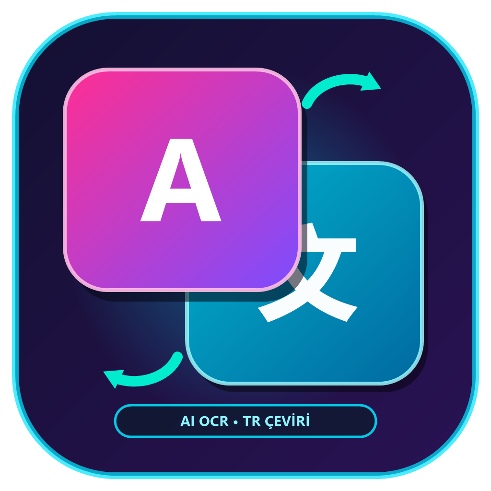

# 🔤 AlpLingo — Gerçek Zamanlı Yapay Zeka Ekran & Oyun Çevirici (AI OCR Overlay)

  

  <b>Oyunlar ve Masaüstü Uygulamaları İçin Şeffaf Tıklama-Geçirgen (Click-Through) Ekran Altyazı & OCR Çeviri İstasyonu</b>

  
  

---

> [!NOTE]
> Bu yazılım tescilli ve kapalı kaynaklı (closed-source) bir masaüstü uygulamasıdır. Derlenmiş resmi ikili dosyaları GitHub Releases ve **AlpTogether** istemcisi üzerinden temin edilebilir.

## 🎯 Temel Özellikler

- **🎮 Oyun İçi Tıklama-Geçirgen (Click-Through) HUD:** Win32 `WS_EX_TRANSPARENT` desteği sayesinde fare tıklamaları altyazıya takılmaz, oyun kesintisiz oynanır.
- **⚡ Yüksek Hızlı OCR:** Dinamik oyun metinleri ve altyazıları filtreleyerek düşük gecikmeyle anında metne döker.
- **🌐 Akıllı Yapay Zeka Çevirisi:** Türkçe dil desteği olmayan oyun ve diyalogları anlamsal bütünlüğü koruyarak çevirir.
- **⌨️ Hızlı Kısayol Tuşları:** F9 / Ctrl+T gibi kısayollarla dilediğiniz diyalog kutusunu seçin veya tüm ekranı çevirin.
- **📦 Tek Parça Native Yürütülebilir (`AlpLingo.exe`):** Harici kurulum gerektirmez, doğrudan çift tıklamayla çalışır.
- **🚀 AlpTogether Entegrasyonu:** [AlpTogether İstemcisi](https://github.com/alphankilicaslan/AlpTogether) üzerinden tek tıkla kurulabilir, güncellenebilir ve onarılabilir.
